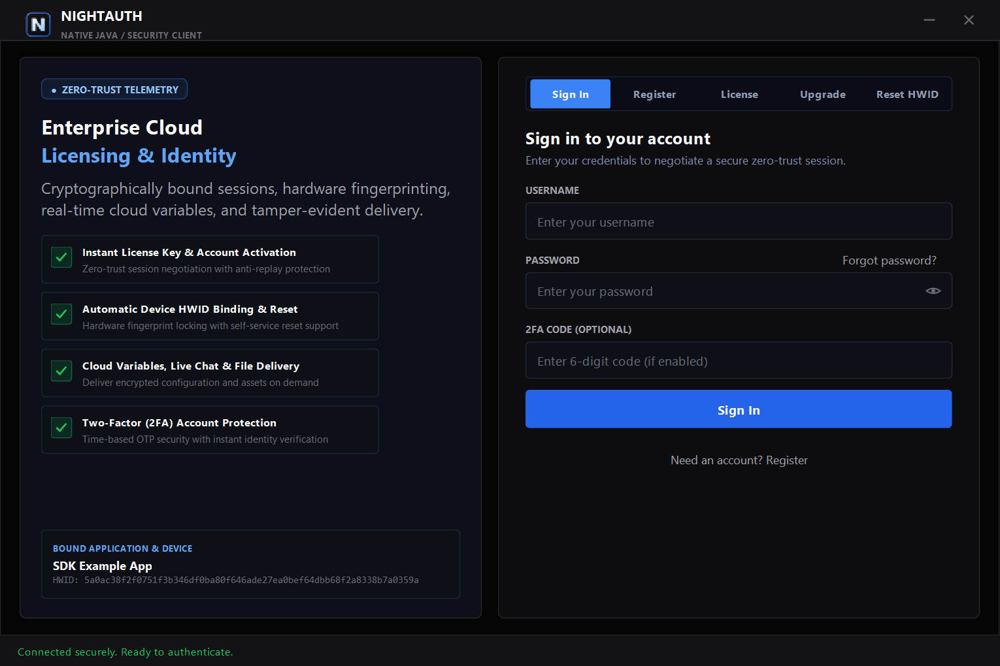
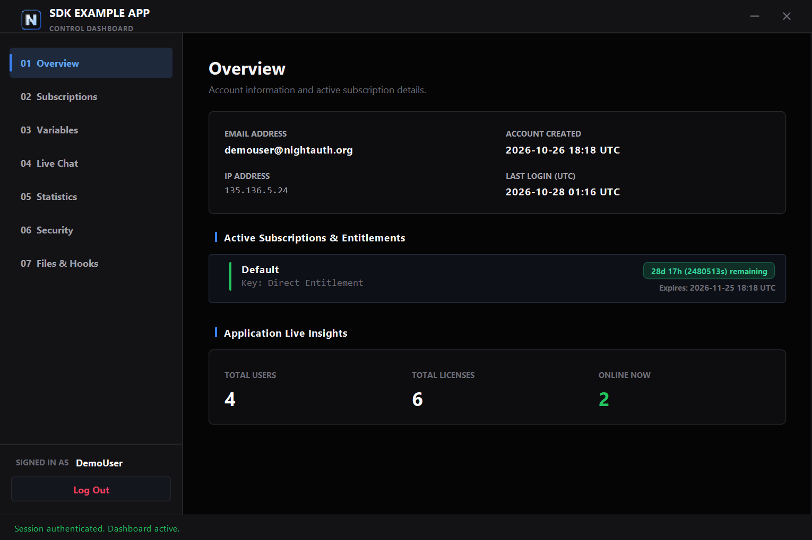
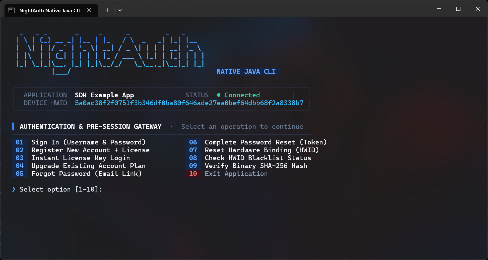
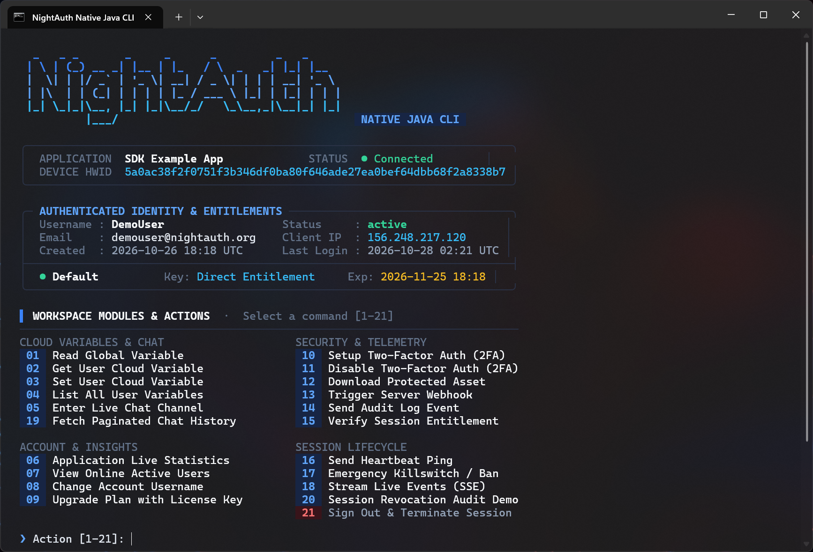

# NightAuth Java SDK — 在 GitHub 上为我们点亮 Star ⭐

官方 **NightAuth** Java SDK 与参考客户端套件（基于 **Java Swing** 的现代化深色桌面客户端与交互式终端 CLI）。几分钟内为您的 Java / JVM 应用程序集成云端授权许可、硬件 HWID 机器码锁定、实时端到端加密聊天以及内存安全模块流式加载，全方位抵御破解与逆向工程。

官方网站: [https://nightauth.org](https://nightauth.org)

---

**Languages / Idiomas / Langues / Sprachen:**  
[English](../README.md) • [Español](es.md) • [Français](fr.md) • [Deutsch](de.md) • [Italiano](it.md) • [Português](pt.md) • [Русский](ru.md) • [Türkçe](tr.md) • [Polski](pl.md) • [中文](zh.md)

---

> [!NOTE]
> ### 📺 视频教程与系统部署指南
> 关于如何在 NightAuth 控制面板中配置应用程序、订阅套餐、云端变量、Webhook 以及授权许可证的官方视频教程和详细图文指南**即将发布**在官方门户与 YouTube 频道。

---

## 📸 运行效果截图

### 桌面图形客户端（Java Swing Obsidian 深色现代主题）

| 登录认证与启动界面 | 控制面板与订阅管理界面 |
| :---: | :---: |
|  |  |

### 终端控制台客户端（交互式命令行 CLI）

| 终端登录界面 | 交互式控制台面板 |
| :---: | :---: |
|  |  |

---

## 🛡️ 官方推荐安全实践

* **字节码混淆与控制流平坦化：** 标准的 Java 字节码 (.class) 极易被 CFR、Procyon、Fernflower 或 JD-GUI 等反编译器逆向。生产发布时，请务必使用商业级混淆器（如 **Zelix KlassMaster (ZKM)**、**ProGuard** 或 **DexGuard**）加密字符串、重命名符号名并混淆控制流。
* **Ahead-Of-Time (AOT) 原生二进制编译：** 推荐使用 **GraalVM Native Image**（`native-image -jar MyApp.jar`）将 Java 应用程序直接编译为独立的原生机器码可执行文件（Windows 下为 .exe，Linux 下为 ELF），彻底剔除 JVM 字节码，使传统反编译器完全失效。
* **内存敏感缓冲区清理：** 在处理完敏感密码、解密后的令牌或加密密钥后，请立即使用零字节覆写内存缓冲区（`Arrays.fill(bytes, (byte) 0)`），防止内存转储分析。
* **内存安全动态执行：** 通过 `NightAuthApp.downloadFile()` 下载受保护的核心业务模块或 JAR 时，**切勿将解密后的字节写入本地物理磁盘**。直接通过自定义内存 `ClassLoader`（`defineClass`）在 RAM 中动态加载，并在执行后立即销毁字节缓冲区。

---

## 📦 环境依赖与项目编译

需要 **JDK 17** 或更高版本（已在 OpenJDK 17、21 和 25 LTS 上经过全面测试）。零外部第三方依赖 — 完全基于 JDK 标准库（`java.net.http`、`javax.crypto`、`java.security`）构建。

### Build & Run Console Client
```bash
# Compile SDK and Console
javac -d build sdk/src/main/java/com/nightauth/sdk/NightAuthApi.java console/src/main/java/com/nightauth/console/Main.java

# Run Console
java -cp build com.nightauth.console.Main
```

### Build & Run Desktop Client (Swing GUI)
```bash
# Compile SDK and Desktop
javac -d build sdk/src/main/java/com/nightauth/sdk/NightAuthApi.java desktop/Main.java

# Run Desktop
java -cp build com.nightauth.desktop.Main
```

### Package Standalone Executable JARs
```bash
# Build Console JAR
jar cfe NightAuth-Console.jar com.nightauth.console.Main -C build .

# Build Desktop JAR
jar cfe NightAuth-Desktop.jar com.nightauth.desktop.Main -C build .
```

---

## ⚙️ 凭证配置与初始化

在 NightAuth 控制台的 **Manage Apps** 选项卡中定义您的应用程序凭据：

```java
import com.nightauth.sdk.NightAuthApi;

public static final String APP_NAME = "";
public static final String APP_API_KEY = "";
public static final String APP_VERSION = "1.0";
public static final String APP_TOKEN = "";

public static NightAuthApi NightAuthApp = new NightAuthApi(
    APP_NAME,
    APP_API_KEY,
    APP_VERSION,
    APP_TOKEN
);
```

### 初始化加密握手 (`init`)

在执行任何其他 SDK 函数之前，必须调用 `init()`。这将建立基于临时 Diffie-Hellman (X25519) 的密钥交换并创建安全加密会话：

```java
NightAuthApp.init();

if (!NightAuthApp.response.success) {
    System.err.printf("Initialization failed: %s\n", NightAuthApp.response.message);
    System.exit(1);
}
```

---

## 🚀 SDK 核心功能开发指南

### 1. 验证会话与黑名单状态

```java
// Validate active session status with the server
if (!NightAuthApp.check()) {
    System.out.printf("Session invalid: %s\n", NightAuthApp.response.message);
}

// Check if client HWID or IP address is blacklisted
String hwid = NightAuthApi.getHardwareId();
if (NightAuthApp.checkBlacklist(hwid)) {
    System.err.println("Access Denied: Machine or IP is blacklisted.");
    System.exit(1);
}
```

### 2. 用户名密码登录（支持 2FA）

```java
if (NightAuthApp.login(username, password, totpCode)) {
    System.out.printf("Welcome back, %s!\n", NightAuthApp.user.username);
} else {
    System.err.printf("Login failed: %s\n", NightAuthApp.response.message);
}
```

### 3. 使用许可证密钥注册

```java
if (NightAuthApp.register(username, password, licenseKey, email)) {
    System.out.printf("Registration successful: %s!\n", NightAuthApp.user.username);
} else {
    System.err.printf("Registration failed: %s\n", NightAuthApp.response.message);
}
```

### 4. 仅使用许可证密钥认证（支持 2FA）

```java
// Authenticate using license key alone or with 2FA TOTP code
if (NightAuthApp.license(licenseKey, totpCode)) {
    System.out.printf("License valid! Logged in as: %s\n", NightAuthApp.user.username);
} else {
    System.err.printf("License authentication failed: %s\n", NightAuthApp.response.message);
}
```

### 5. 升级账户 / 兑换许可证密钥

```java
if (NightAuthApp.upgrade(username, licenseKey)) {
    System.out.printf("Account upgraded: %s\n", NightAuthApp.response.message);
} else {
    System.err.printf("Upgrade failed: %s\n", NightAuthApp.response.message);
}
```

### 6. 重置硬件 ID（HWID 绑定）

```java
if (NightAuthApp.resetHwid(username, password, totpCode)) {
    System.out.println("Hardware fingerprint reset successfully.");
} else {
    System.err.printf("HWID reset failed: %s\n", NightAuthApp.response.message);
}
```

### 7. 忘记密码 / 账户找回

```java
// Step 1: Request recovery email link
NightAuthApp.forgotPassword("user@example.com");

// Step 2: Complete reset using token received via email
if (NightAuthApp.resetPassword(resetToken, newPassword)) {
    System.out.println("Password updated successfully.");
}
```

### 8. 用户个人资料 (`NightAuthApp.user`)

```java
NightAuthApi.UserData u = NightAuthApp.user;
System.out.printf("Username: %s\n", u.username);
System.out.printf("Email: %s\n", u.email);
System.out.printf("HWID: %s\n", u.hwid);
System.out.printf("Client IP: %s\n", u.ip);
System.out.printf("Account Status: %s\n", u.status);
System.out.printf("Created At: %s\n", u.createdAt);
System.out.printf("Last Login: %s\n", u.lastLoginAt);
System.out.printf("2FA Enabled: %b\n", u.twoFactorEnabled);

for (NightAuthApi.SubscriptionData sub : u.subscriptions) {
    System.out.printf("Tier: %s | Key: %s | Expires: %s | Seconds Left: %d\n",
        sub.subscription, sub.key, sub.expiry, sub.timeLeft);
}
```

### 9. 全局云变量

```java
String motd = NightAuthApp.getGlobalVar("server_motd");
System.out.printf("Announcement: %s\n", motd);
```

### 10. 用户专属变量

```java
// Retrieve a per-user encrypted variable
String theme = NightAuthApp.getUserVar("custom_theme");

// Set or update a per-user variable
NightAuthApp.setUserVar("custom_theme", "dark_obsidian");

// Fetch all per-user variables
if (NightAuthApp.getUserVariables()) {
    Object vars = NightAuthApp.response.payload != null ? NightAuthApp.response.payload.get("variables") : null;
}
```

### 11. 应用程序审计日志

```java
NightAuthApp.log("User initialized workflow #42");
```

### 12. 封禁用户并加入设备黑名单

```java
NightAuthApp.ban("Security tampering detected");
```

### 13. 服务端 Webhook 与文件上传

```java
// 1. Trigger JSON payload webhook
Map<String, Object> payload = Map.of("event", "user_action", "score", 42);
NightAuthApi.WebhookResult result = NightAuthApp.triggerWebhook("webhook-id", payload);
if (result != null && result.success) {
    System.out.printf("Webhook response (HTTP %d): %s\n", result.status, result.data);
}

// 2. Upload file securely via server-side webhook proxy
byte[] reportBytes = "Audit dump content...".getBytes(java.nio.charset.StandardCharsets.UTF_8);
NightAuthApi.WebhookResult fileResult = NightAuthApp.triggerWebhookFile("webhook-id", reportBytes, "audit.log", payload);
```

### 14. 内存中安全文件下载

```java
byte[] fileData = NightAuthApp.downloadFile("asset_file_id");
if (fileData != null) {
    // Process or load payload directly into memory (e.g. ClassLoader defineClass)
    // Wipe buffer from memory immediately after execution:
    java.util.Arrays.fill(fileData, (byte) 0);
}
```

### 15. 实时加密聊天频道

```java
// Fetch recent message history
List<NightAuthApi.ChatMessage> messages = NightAuthApp.getChatMessages("general", 0L, true);
for (NightAuthApi.ChatMessage msg : messages) {
    System.out.printf("[%s] %s: %s\n", msg.timestamp, msg.author, msg.message);
}

// Send a message to a channel
NightAuthApp.sendChatMessage("Hello from Java SDK!", "general");
```

### 16. 实时事件流（Server-Sent Events）

```java
NightAuthApi.EventSubscription sub = NightAuthApp.subscribeEvents((payload) -> {
    System.out.printf("[EVENT] %s\n", payload);
});

// Close event stream when finished
sub.close();
```

### 17. 双因素身份验证 (2FA / TOTP)

```java
// Step 1: Initialize TOTP setup
NightAuthApi.TwoFactorSetupData setup = NightAuthApp.setup2FA();
if (setup != null) {
    System.out.printf("Secret: %s | URI: %s\n", setup.secret, setup.uri);
}

// Step 2: Confirm with 6-digit TOTP code
NightAuthApi.TwoFactorConfirmData conf = NightAuthApp.confirm2FA("123456");
if (conf != null) {
    System.out.println("2FA Activated! Backup Codes:");
    for (String code : conf.backupCodes) {
        System.out.printf(" - %s\n", code);
    }
}

// Step 3: Disable 2FA if needed
boolean disabled = NightAuthApp.disable2FA(password, "123456");
```

### 18. 会话生命周期与注销

```java
// Keep session active with periodic ping
NightAuthApp.heartbeat();

// Revoke session on cloud and close client
NightAuthApp.logout();
NightAuthApp.close();
```

### 19. 修改账户用户名

```java
if (NightAuthApp.changeUsername("new_alias", "CurrentPassword123!")) {
    System.out.printf("Username changed successfully to: %s\n", NightAuthApp.user.username);
} else {
    System.err.printf("Change username failed: %s\n", NightAuthApp.response.message);
}
```

### 20. 应用统计分析与在线用户列表

```java
// Retrieve application usage statistics
NightAuthApi.AppStats stats = NightAuthApp.getStats();
if (stats != null) {
    System.out.printf("Users: %d active / %d total | Licenses: %d used / %d total\n",
        stats.activeUsers, stats.totalUsers, stats.usedLicenses, stats.totalLicenses);
}

// Fetch list of currently online usernames
List<String> onlineUsers = NightAuthApp.getOnlineUsers();
System.out.printf("Online users (%d): %s\n", onlineUsers.size(), String.join(", ", onlineUsers));
```

### 21. 文件完整性校验与哈希比对

```java
String fileSha256 = "e3b0c44298fc1c149afbf4c8996fb92427ae41e4649b934ca495991b7852b855";
if (NightAuthApp.verifyFileHash(fileSha256)) {
    System.out.println("Binary matches registered server checksum.");
} else {
    System.err.println("Integrity verification failed!");
}
```

### 22. 硬件指纹提取 (`getHardwareId`)

```java
// Retrieve stable hardware fingerprint identifier
String hwid = NightAuthApi.getHardwareId();
System.out.printf("Device HWID: %s\n", hwid);
```

### 23. 独立配置、超时设置与自定义服务端公钥

```java
// Pin server signing (Ed25519) and sealed-box (X25519) public keys
NightAuthApi.PinnedKeys pinned = new NightAuthApi.PinnedKeys(
    "cdb2285db481666ce40003aadb874c8751dbeb9a0672a37f740dfe881ecdc742",
    "b773fc4f6cf1a0938e78e714c3d84cb386584bea24728923008471a6cd203213"
);

// Initialize with custom API endpoint and pinned keys
NightAuthApi customAuth = new NightAuthApi(
    "Custom App",
    "na_custom_key",
    "1.0",
    null,
    "https://nightauth.org/api/v1",
    false,
    pinned
);

// Configure HTTP request timeout
customAuth.setRequestTimeoutMillis(15000);
```

### 24. 签名自更新与防回滚保护

```java
// Download and verify Ed25519 digitally signed update manifest with monotonic sequence protection
String downloadedJar = NightAuthApi.SignedUpdateInstaller.download(
    "https://releases.example.com/manifest.json",
    "cdb2285db481666ce40003aadb874c8751dbeb9a0672a37f740dfe881ecdc742",
    "SDK Example App",
    "updates/app-v2.0.jar"
);
System.out.printf("Verified update downloaded to: %s\n", downloadedJar);
```

---

## 🖥️ 运行终端与桌面客户端

```bash
# Interactive Terminal Console Client
javac -d build sdk/src/main/java/com/nightauth/sdk/NightAuthApi.java console/src/main/java/com/nightauth/console/Main.java
java -cp build com.nightauth.console.Main

# Modern Java Swing Desktop Client
javac -d build sdk/src/main/java/com/nightauth/sdk/NightAuthApi.java desktop/Main.java
java -cp build com.nightauth.desktop.Main
```

---

## 📄 许可证

本项目采用 **Elastic License 2.0** 许可证。

* 您不得将本软件作为托管或托管服务提供给第三方。
* 您不得移动、更改、禁用或规避许可证密钥功能。
* 您不得更改、删除或掩盖任何许可或版权声明。

完整法律文本请参阅 [LICENSE](../LICENSE) 文件。
